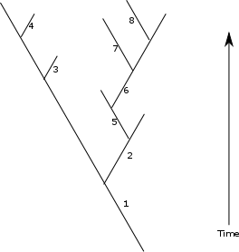
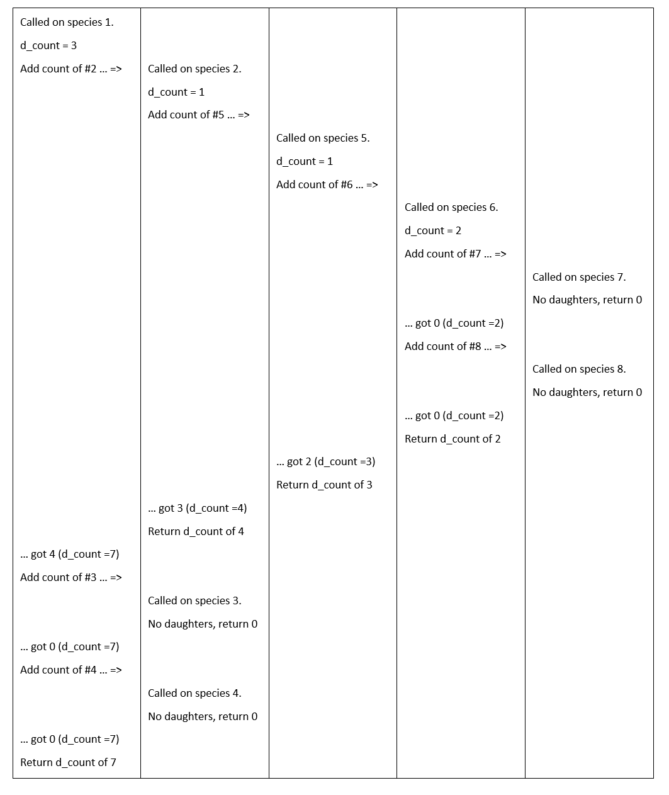

# Recursion – advanced and very much optional!

Recursion is a programming trick that involves functions that call themselves – these are called *recursive functions*, and we term the act of a function calling itself *recursing*. It’s only appropriate for some types of problem, but where it *is* appropriate it’s typically the most elegant and easiest way to proceed – once you’ve got your head round it. Recursion is a relatively advanced technique, and is only ‘on the edge’ of the syllabus of this module – you should be aware that it exists and have some idea what it is, but actually using it is beyond the core of what I expect you to be able to do, especially if you’ve not programmed before. The best way to explain how recursion works is by example, so, read on.

Imagine an evolutionary tree derived from a computer simulation of evolution. A real tree from such software might have thousands of species, but we’ll consider a very simple one with only eight. It might look something like this:



Our task in this example – write a function that tells us, for any particular species, how many descendant species it has *in total*, i.e. including all the descendants of its daughter species. For species #1 it should return 7, for species #5 it should return 3, etc. Let’s imagine, before we start this, that we have already made a dictionary for the whole dataset to list immediate descendants – this dictionary has a key of species ID, and its value is a *list* of the species IDs of the immediate daughters of that species. For our simplified example dataset, the entire dictionary (I’ll call it daughters) would look like:

```python
daughters ={1:[2,3,4], 2:[5], 3:[], 4:[], 5:[6], 6:[7,8], 7:[], 8:[]}
```

So… how can we use this to get the ‘total descendant species count’ for a species? Well it IS possible to do it without recursion, but it's not straightforward. WITH recursion though it involves very little coding. In a recursive-coding approach, we want to break down the problem into one where we ask the same question of species repeatedly. Here, the total descendant species count for any species is the number of species in its daughter list, plus the total descendant species count of each of its daughters. That’s fine and obvious, but how do we work out the total descendant species count of the daughters? The answer is – with exactly the same method! It’s the number of species in *its* daughter list, plus the total descendant species count of each of *its* daughters. That will seem a bit circular at first, but actually that’s all you need! Let’s write the function.

```python
def total_descendant_species_count(speciesID):
    descendant_count = len(daughters[speciesID])  # count of direct daughters
    # loop over all daughter species IDs in the list in the dictionary
    for daughter in daughters[speciesID]:
        # recursively call this function to find their count – and add it
        descendant_count += total_descendant_species_count(daughter)
    return descendant_count  # done – return the total count
```

That’s it! Only three lines of ‘active’ code  - the rest is just comments, function def line, and the return line. In English, this sets **descendant_count** to the number of immediate daughters, then for each of the daughters, gets *their* total by calling itself on them in turn, and adds their counts to **descendant_count**. Finally then it returns the total – direct descendant count of this species plus direct descendant count of all daughters. So it just implements my simple sentence above – the count we want is the number of species in the daughter list, plus the total descendant species count of each of the daughters.

> **Technical note:** I’ve assumed that the `daughters` dictionary is a global – i.e. defined in the main code outside a function, so that this function can see it. If it isn’t (e.g. if it’s defined in a function), you’d need to pass it into the recursive function as a second argument, so the function can access it.

**HOW can this work?** It seems to constantly pass the buck! Well… first think about what happens when it’s called on species 3, which has no descendants. The list in the dictionary will have length 0, so the first line sets descendant_count to 0. The loop is simply skipped – there are no elements in **daughters[3]**,  so the recursing line doesn’t ever get executed. So… it just returns 0 at the end (which is correct of course, species 3 has 0 descendants). We no longer need to think about this then – we now know that if called on a species with no descendants, the function doesn’t recurse anymore, it just returns 0.

Now think about what happens when it’s called on species 6. Species 6 has two daughters, each of which has no daughters of its own. So… first, it will set **descendant_count** to 2 (as the length of the list in the dictionary for ID 6 is 2). It then loops over the daughter list, which contains 7 and 8. First it calls itself on species 7 – we already know (last paragraph) that this will return 0 – and adds that 0 to **descendant_count**, leaving it on 2. The same then happens for species 8 – the function call returns 0, **descendant_count** stays at 2. Finally, it returns its **descendant_count** of 2 (which is once again correct – there are indeed 2 total descendants of species 6).

Now, finally, let’s look at what happens if you call the function on species 1. This will have many more levels of recursion, so I’ll write it out with each level of recursion as a column in a table. Note that in this table I’ve used **d_count** for **descendant_count** for space reasons.




… and the result (7) is correct – 5 from the branch starting with #2, plus the two daughterless species #3 and #4. The function has recursed over the entire tree, and added all the species together. Notice that the concept of local variables is vital to how this works – the ‘descendant_count’ used by each ‘instance’ of the function is separate, so the first ‘level’ of iteration is keeping its own copy of ‘descendant_count’ intact as all the other ‘deeper’ recursions are creating and using theirs. Remember how I said weeks ago that local variables were important for implementing programming tricks? This is what I was talking about.

If you understand how that works – then you understand recursion. Remember that recursive functions must always have some type of data where they don’t recurse deeper, or you will have something akin to an infinite loop. In our example this ‘stop’ point is species without descendants.

For dealing with ‘tree-like’ data such as this, recursion is an essential tool to have in your toolbox. For other types of data, it might be less useful, but tree-like data-structures and problems are more common than you might think. Navigating folder structures on a computer is an example – if you want to sum up the total size of all files within a folder and all sub-folders within it – you have a tree-like structure, and you use recursion. Look out for tree-like data and be prepared to handle it in this way when it appears.

[Return to the site index](index.md)
